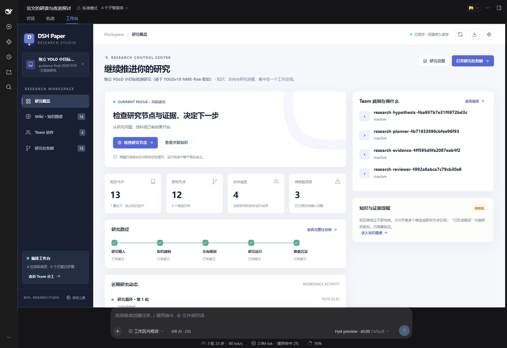
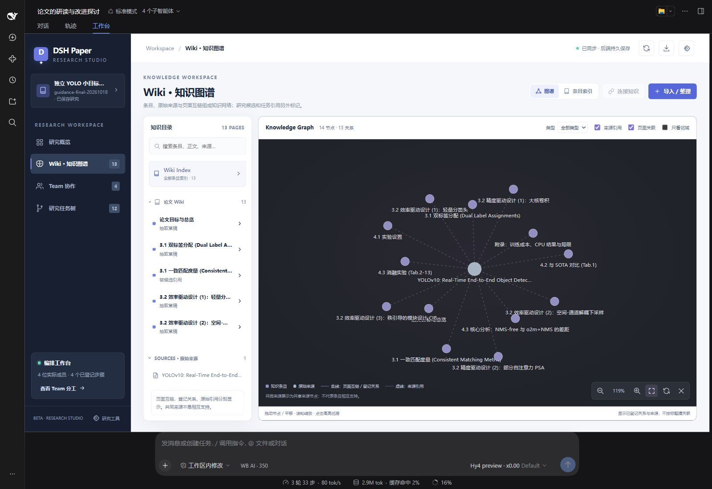
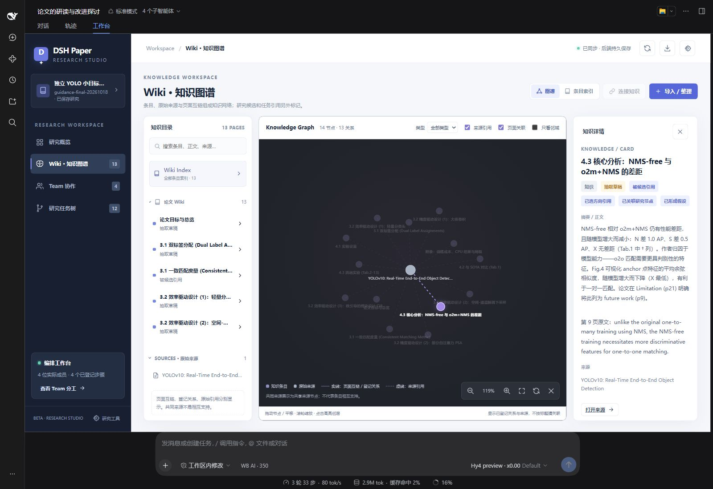
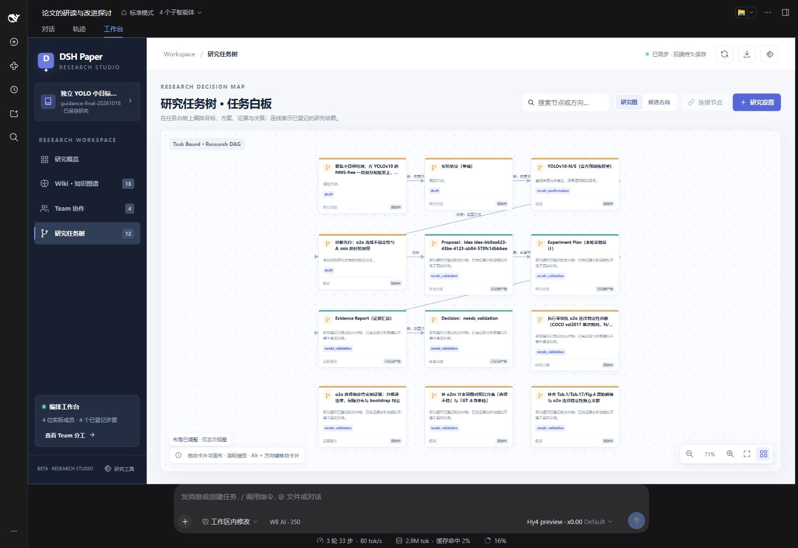
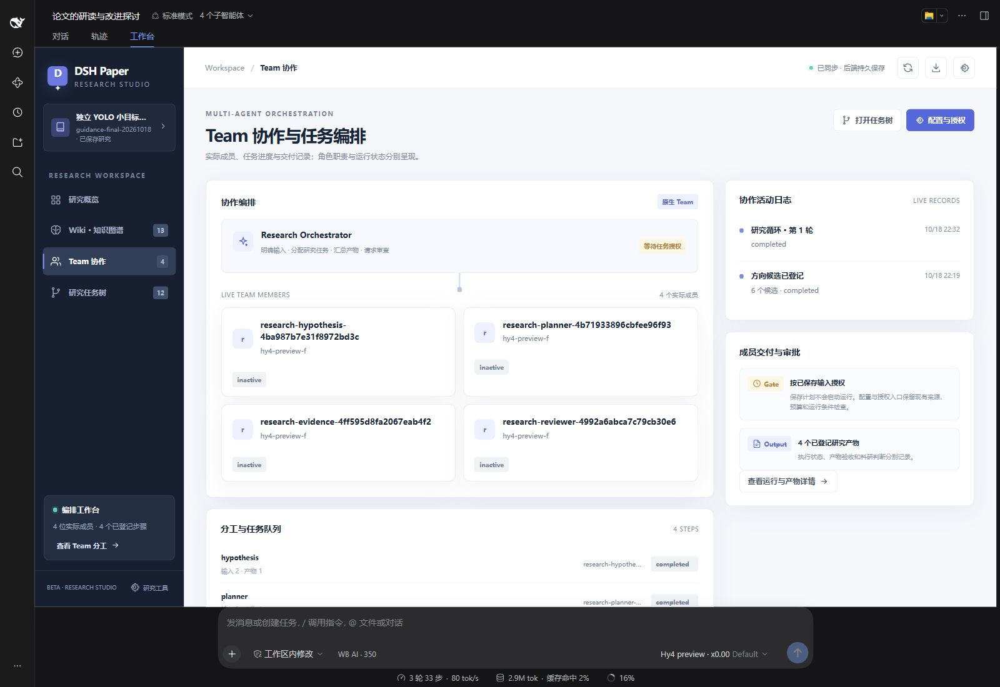
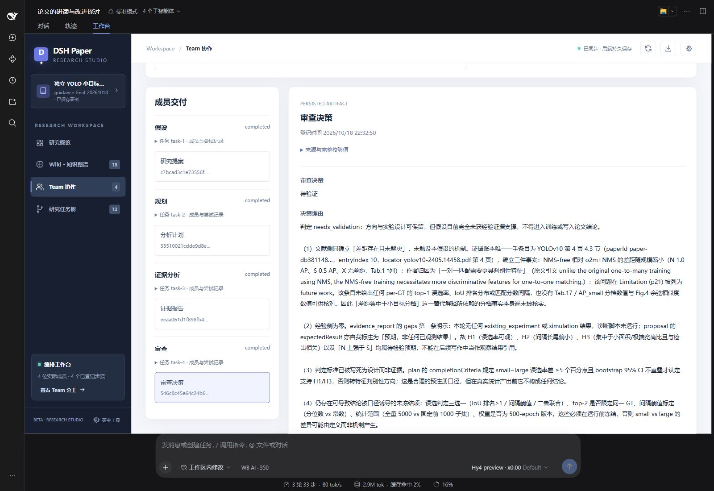
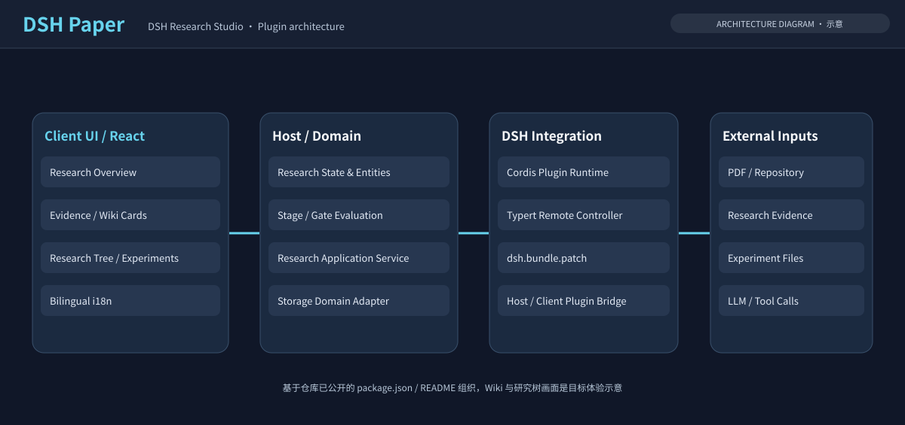

# DSH Paper · Research Studio

> **From Research Ideas to Traceable Decisions**  
> 一个围绕论文证据、研究 Wiki、研究计划与实验记录构建的 Agent 辅助科研工作台。

[DeepSeek Harness](https://github.com/deepseek-ai/deepseek-harness)



> **展示说明：** 工作台、Wiki、Team 和研究树图片来自同一场真实 DSH 运行。Agent 整理了 13 条 Wiki，4 位原生 Team 成员完成 4 项任务、登记 4 份产物，研究树保存 12 个节点；刷新后仍可恢复。本次未执行训练或诊断实验，Reviewer 结论为 **needs_validation（待验证）**。架构图仍为示意，完整十轮 Mock 实验验收尚未重跑。

## 🎯 What is DSH Paper?

真实研究并不总从一张空白计划表开始。用户可以提供论文 PDF、已有仓库、实验表格，或者一句不完整的研究想法。DSH Paper 的目标是让这些入口汇入一个持续维护的 Research Workspace：

1. **Understand：** 整理研究材料及其来源，不丢失原始证据。
2. **Connect：** 生成具有引用和争议关系的 Wiki 卡片。
3. **Plan：** 将待验证的问题转为实验分支与人工确认的研究计划。
4. **Iterate：** 根据新增实验结果修订知识与后续研究路径。

## 🧭 从哪个入口开始？

DSH Paper 提供 11 个可单独调用的研究入口。在 DSH 对话框输入 `/`，可查看名称与用途；也可以直接用自然语言提出当前需求，Agent 根据已有研究状态按需加载对应 Skill。

| 入口 | 用途 | 主要交付 |
| --- | --- | --- |
| `/paper-start` | 从论文开始 | 最小研究草稿、初始 Wiki、原文引用 |
| `/wiki` | 整理论文知识 | 带页码与精确原文引用的 Wiki |
| `/organize-wiki` | 整理已有知识 | 主题条目、页面互链、条件与反证 |
| `/extract` | 拆解基线与模块 | 有出处的 Baseline、研究组件与模块 |
| `/brain-storm` | 寻找改进方向 | 候选假设、依据、验证方案与代价 |
| `/make-dag` | 安排研究计划 | 规划任务树、依赖、Slot 与候选映射 |
| `/analyze-results` | 分析上传结果 | 指标比较、可比性检查与后续建议 |
| `/research-team` | 组织研究协作 | 分工建议、真实运行状态与产物读取 |
| `/research-review` | 复核研究证据 | 主张边界、证据缺口与审阅建议 |
| `/research-resume` | 下次继续研究 | 恢复 Wiki、研究树、Team 进度和待办 |
| `/academic-tailor` | 学术裁缝 | 按阶段组织基线、来源模块、兼容分析与对照消融 |

**按需推进：** 各入口复用同一研究工作区，不要求从头执行整条流水线。`/academic-tailor` 会根据当前阶段加载需要的指导；`A+b+c` 是组织验证的方法，不是保证提升的公式。Wiki 表达知识关系，任务树表达研究规划与依赖，二者通过真实引用关联，无需一一对应。

### 三个最短使用示例

**从论文开始** · 附上 PDF，输入：

```text
/paper-start 我想基于这篇论文做点改进，先帮我看看。
```

保存初始知识后，再提出当前需求，例如 `/brain-storm 有什么简单、适合先试的方向？`。选定方向后用 `/make-dag 先帮我安排实验，我自己去跑。` 整理规划；方向选择和关键确认遵守工作台的原生用户入口。

**带回实验结果** · 附上结果文件，输入：

```text
/analyze-results 帮我比较这些结果，提升有多大、代价是什么，条件是否一致？
```

先核对来源、配置与评估条件，再讨论指标；不具可比性的结果分组保留。`is_mock: true` 的文件始终标明模拟，不作为真实科研成果。具体入库以可用工具的真实回执为准。

**下次继续** · 在同一研究工作区开启新会话，输入：

```text
/research-resume 我们继续之前的研究，现在到哪一步了？
```

读取持久化的研究状态、论文库和 Team 记录，区分已完成产物与未执行计划，再提出下一步。

**执行边界：** Skill 不自动授予训练或 Team 运行权限；Team 启动仍通过原生工作台授权。主会话的 `/research-review` 建议不冒充已分配 Reviewer 的正式交付。当前 Beta 的研究演示未执行真实训练。

## 🧩 Core Features

| 能力 | 期望的用户体验 | 应保留的工程信息 |
| --- | --- | --- |
| 材料工作区 | 输入论文、仓库、实验文件 | 来源类型、时间、版本及解析结果 |
| Evidence Wiki | 卡片里直接看到观点、摘要与引用 | 原始出处、证据强度、冲突状态 |
| Research Planning | 从想法生成可修改的研究方向 | 研究假设、依赖、人工确认 |
| Research Tree | 展示不同方案、结果与回退路径 | 计划版本、分支依据与状态 |
| Experiment Records | 导入与比较实验数据 | 基线、环境、指标和实验产物 |
| Agent Orchestration | 让 Agent 辅助执行与整理任务 | 工具调用、Gate、执行记录 |

### 01 · 以证据为核心的 Wiki

Wiki 不只是论文摘要列表，也不只是向量检索结果。知识卡片需要直接展示**论点、来源、关联研究与待核查信息**；对于新证据与原结论相冲突的情况，优先记录冲突，而不是自动覆盖。





本次图谱含 13 条知识与 1 个 PDF 来源节点，13 条连线为来源引用；共同来源不代表条目相互支持。条目另有“被候选引用”“已关联研究节点”“已形成假设”等研究使用标签。

示例知识更新策略：`new evidence → compare → mark conflict / revise / create → keep provenance`。

### 02 · 可继续生长的研究树

研究计划不是强制线性的六步向导。新用户可以从论文进入，已有项目也可以导入代码、旧实验与时间线，重新组织当前的研究状态。



本次 12 个节点包含 4 个基础规划节点、4 个已登记交付节点和 4 项后续待办。后续待办仍是规划，不代表实验已执行；未登记依赖的待办独立显示。

研究树每个分支至少应关联**研究假设、参考材料、验证指标、当前实验、结论与下一步动作**。实验失败不会使整棵树失效，分支可修订、回退或保留为被否定的假设。

## 🔬 Showcase · 一次渐进式 YOLO 研究

下面展示一次已完成的**论文理解 → 候选生成 → 用户选择 → Team 分析 → Reviewer 决策 → 研究树更新**。输入为 YOLOv10 PDF，本次没有上传 Mock 结果，也没有运行模型训练。

**1. 用户上传论文：**

> 我想基于这篇论文做点改进，先帮我看看。

Agent 创建研究并保存 13 条带出处的 Wiki 和 10 个研究组件。

**2. 用户询问方向：**

> 你觉得有什么适合先试的方向？

Agent 保存 6 个候选方向，建议先诊断 o2o 选择稳定性，再决定改进方法；文献查新尚未完成，因此候选不作为已确认的新颖选题。

**3. 用户确认范围并选择方向：** 独立的小目标研究，仅做诊断设计与规划。通过工作台选中“诊断先行”方向，建立研究图。

**4. 用户通过工作台授权 Team 分析已有证据：** 四位真实成员依次完成假设、分析计划、证据报告和审查决策。交付物持久保存，并逐份通过 SHA-256 校验。



**5. Reviewer 将结论和后续任务写回研究树：** 当前没有直接实验数据，结论为 **needs_validation**。方向保留，测量口径、权重版本、对照和文献缺口列为后续工作。



**验收范围：** 三个入口的内容已真实保存，刷新恢复及产物详情读取通过。本次证明知识整理与研究协作链路可用；两批 Mock 导入、不可比性负向测试及完整十轮验收不在本次通过范围内。

## 🏗 Architecture



当前仓库采用 DeepSeek Harness 插件方式组织，主要包含：

| Package | Path | Responsibility |
| --- | --- | --- |
| `@dsh/evolver` | `packages/evolver` | Host 端领域模型、服务、状态与存储适配 |
| `dsh-evolver-ui` | `packages/evolver-ui` | React Web Client 与研究视图 |
| `dsh-evolver-bundle` | `packages/evolver-bundle` | Cordis 插件配置与 Host / Client 挂载 |

源码设计原则包括 **Host authoritative state**、**Stage 与 Agent Loop 解耦**、**确定性 Gate 校验**、**Typert Remote 通信**。包路径与名称以当前源码为准；架构图用于说明模块关系。Wiki、Team 和研究树的实机展示见上文。

## 🚀 Quick Start / Development

需要 **Node.js 24+、npm、Git 与兼容的 DeepSeek Harness Desktop**。这是 DSH 宿主扩展，不能脱离宿主独立启动；宿主平台模块由本机安装提供，仓库不包含 API key 或模型配置。

在仓库根目录执行：

```bash
npm ci
npm run install:host
npm run install:tools
npm run build
npm run typecheck
npm test
```

`install:host` 根据本机 DSH 安装重新建立平台模块链接，安装记录不提交。配置好自己的模型后，将插件挂载到已有的独立测试 profile：

```bash
# 将 <profile> 替换为你已创建的 DSH profile 名称或目录
node scripts/release/install-profile.mjs --profile <profile>
```

脚本生成与当前源码位置绑定的 overlay，并备份现有 patch；不会自动创建 profile 或启动宿主。按 DSH 的 profile 启动方式打开该 profile 后，进入工作台，或在对话框输入 `/` 选择研究入口。模型与联网搜索服务分别使用用户自己的本机配置；缺少服务时如实报告不可用。

## 🧪 Project Status

| 范围 | 说明 |
| --- | --- |
| 仓库现有基础 | Host Domain、React Client 插件、Cordis Bundle、构建 / 测试脚本 |
| README UI | 工作台、Wiki、Team、研究树为实机截图；架构图为示意 |
| Wiki / Team / Research Tree | 本次实测 13 条 Wiki、4 位成员 / 4 份产物、12 个研究节点；刷新恢复通过 |
| Skill 入口 | 9 个新增原生 Skill + 2 个既有命令；菜单与只读研究恢复实测通过，未逐个重跑完整模型验收 |
| YOLO 演示 | 真实 Agent 论文分析与规划；未训练、无实测改进收益，审查结论待验证 |

## 📌 Next Steps

- [x] 用真实运行截图替换 Workbench / Wiki / Research Tree 占位图
- [x] 完成论文导入 → Wiki → 方向选择 → Team 分析 → 研究树更新的展示验证
- [ ] 增加证据冲突与知识更新 Diff 的案例
- [ ] 展示研究树在新增实验结果后的状态变化
- [ ] 记录可复现命令、测试输出与真实实验产物

## 📄 License

本项目采用 MIT，详见 [LICENSE](LICENSE)；第三方依赖声明见 [THIRD_PARTY_NOTICES.md](THIRD_PARTY_NOTICES.md)。
